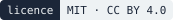

<picture>
  <source media="(prefers-color-scheme: dark)" srcset="assets/banniere-readme-sombre.png">
  
</picture>

<p>
  
  
  
  
</p>

Skill pour **Claude Code** et **Codex** qui lit le PLUi de Saint-Quentin-en-Yvelines (Élancourt, Guyancourt,
La Verrière, Magny-les-Hameaux, Montigny-le-Bretonneux, Trappes, Voisins-le-Bretonneux) : à partir d'une adresse, il
donne la zone, les règles citées page par page dans le règlement en vigueur, les contraintes de la parcelle, et
vérifie un projet de construction.

> **Projet non officiel, bénévole et sans but commercial.** Il n'est ni édité ni validé par Saint-Quentin-en-Yvelines
> ou un service de l'État. Ses résultats ne remplacent ni un certificat d'urbanisme ni l'avis du service instructeur.

## Ce qu'il sait faire

| Commande (Claude Code) | Rôle |
|---|---|
| `/plui-sqy:fiche <adresse>` | Fiche de la parcelle : cadastre, zone, prescriptions, servitudes, terrain, bâtiments voisins, zones naturelles, gares, risques, fonds de plan |
| `/plui-sqy:regles <zone> [articles]` | Articles du règlement en vigueur pour un code de zone, avec les pages |
| `/plui-sqy:verifier <adresse> <projet>` | Verdict article par article d'un projet (recul, retraits, emprise, hauteur, stationnement, espaces verts) |
| `/plui-sqy:masse <adresse>` | Fond du plan de masse (PCMI2) |
| `/plui-sqy:situation <adresse>` | Fond du plan de situation (PCMI1) |
| `/plui-sqy:veille` | Vérifie si le PLUi a changé depuis la version vérifiée |

Sans commande, une question comme « que puis-je construire au … à Trappes ? » déclenche aussi le skill.

## Installation

**Claude Code**
```
/plugin marketplace add Bilna781/plui-sqy
/plugin install plui-sqy@plui-sqy
```
Mise à jour : `/plugin marketplace update plui-sqy`.

**Codex** : copier le dossier `.agents/skills/plui` dans le dossier de skills de Codex (ou garder ce dépôt comme
projet : Codex lit `.agents/skills`), puis appeler `$plui`.

**Prérequis** : Python 3.10 ou plus et [uv](https://docs.astral.sh/uv/) (installe les dépendances tout seul), ou
`pip install shapely pyproj numpy pymupdf`. Aucune clé d'API.

## Suivi des versions du PLUi

| Version du PLUi | Statut | Publiée sur le Géoportail de l'Urbanisme |
|---|---|---|
| 200058782_PLUi_20260219 | **en vigueur**, vérifiée par ce skill | 26/03/2026 |
| 200058782_PLUi_20251113 | archivée | 09/12/2025 |
| 200058782_PLUi_20250620 | archivée | 26/08/2025 |
| 200058782_PLUi_20250410 | archivée | 05/06/2025 |
| 200058782_PLUi_20230413 | archivée | 26/06/2023 |
| 200058782_PLUi_20200305 | archivée | 29/09/2020 |

Chaque lundi, une GitHub Action compare l'historique officiel du Géoportail de l'Urbanisme, les PDF publiés par SQY
et le règlement en vigueur ([veille/check.py](veille/check.py)). Au moindre écart, elle ouvre une issue
« Veille du PLUi ». Après relecture, une nouvelle version du skill est publiée : les tags combinent version du skill
et version du PLUi (`v1.0.0+plui-20260219`). Pour être prévenu : *Watch → Custom → Releases*.

Le skill lit toujours le règlement **en vigueur** (lien fourni par le Géoportail de l'Urbanisme) et signale quand
celui-ci diffère de la version sur laquelle il a été vérifié.

## Données, licences et mentions

| Source | Licence |
|---|---|
| PLUi de Saint-Quentin-en-Yvelines, via le Géoportail de l'Urbanisme | Licence Ouverte |
| IGN Géoplateforme : géocodage, cadastre, BD TOPO, altimétrie, Plan IGN, orthophotos, isochrones | Licence Ouverte Etalab 2.0 |
| Géorisques (ministère de la Transition écologique, BRGM) | Licence Ouverte 2.0 |

Chaque fiche contient les mentions de source datées (`CREDITS.txt`). Les PDF du PLUi ne sont pas redistribués : seuls
leurs liens officiels sont utilisés. Détails, limites de requêtes et données personnelles : [NOTICE.md](NOTICE.md).

**Données personnelles** : aucune collecte. L'adresse saisie n'est envoyée qu'aux API publiques ci-dessus ; les
fiches restent sur votre machine. Ne publiez jamais votre adresse dans une issue.

## Contribuer
Voir [CONTRIBUTING.md](CONTRIBUTING.md), le [code de conduite](CODE_OF_CONDUCT.md) et [SUPPORT.md](SUPPORT.md).

## Licence
Code sous [MIT](LICENSE). Documentation, logo et illustrations sous [CC BY 4.0](LICENSE-docs).
Polices Archivo, Public Sans et IBM Plex Mono sous SIL Open Font License 1.1.
