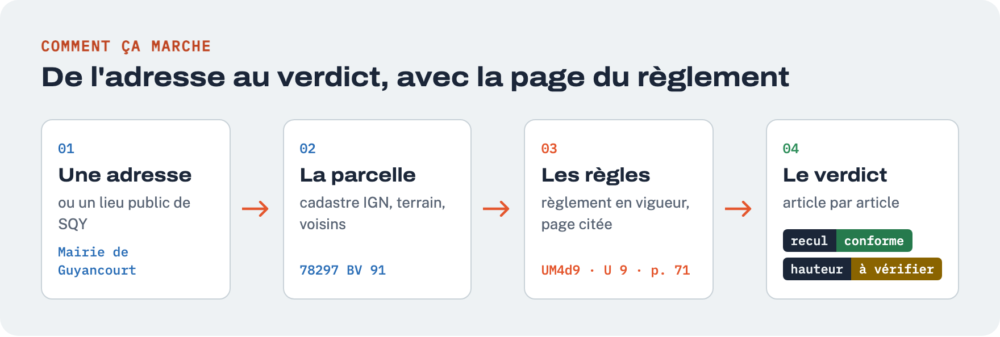
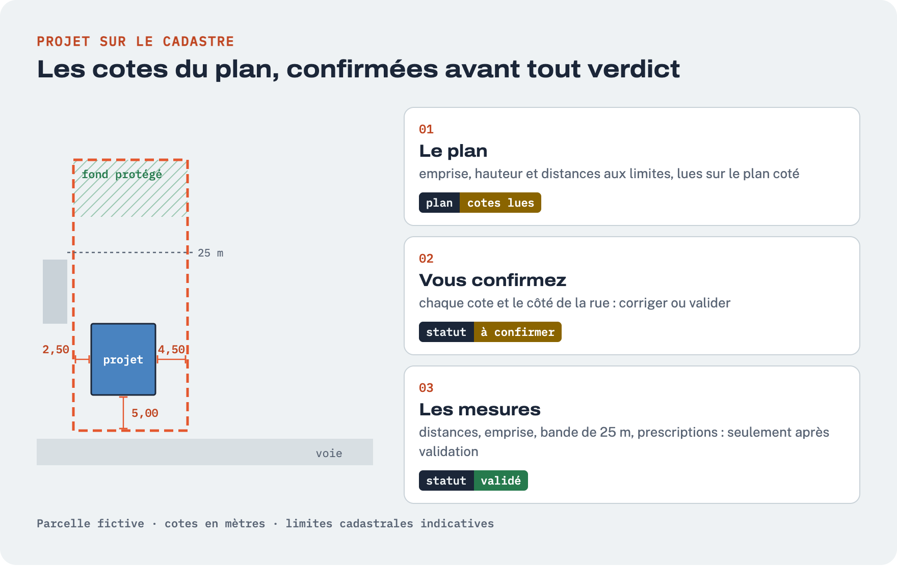
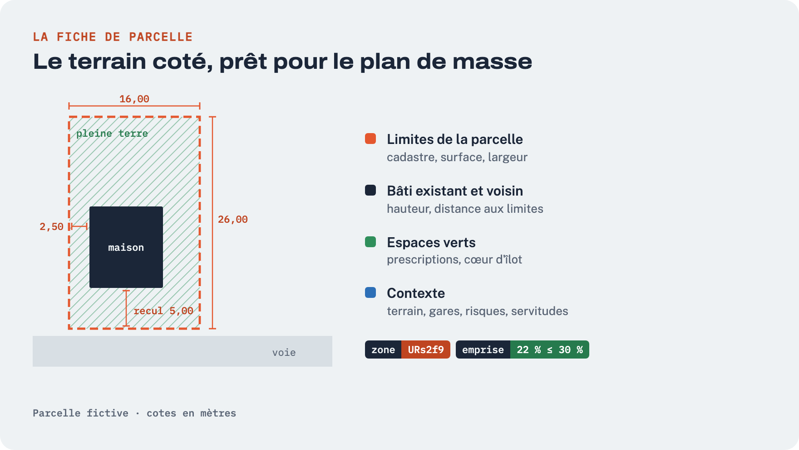
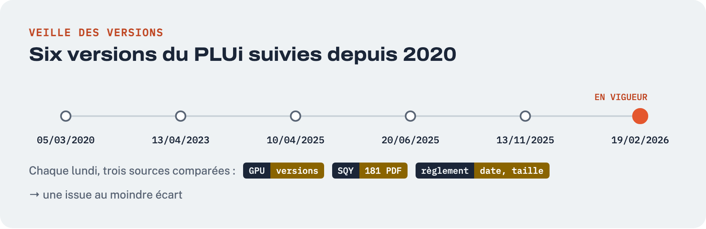
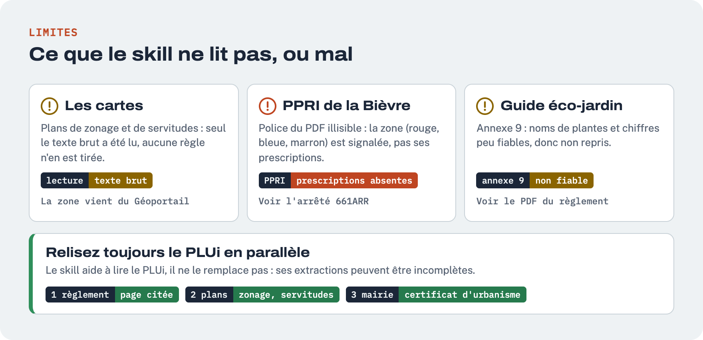

<picture>
  <source media="(prefers-color-scheme: dark)" srcset="assets/banniere-readme-sombre.png">
  
</picture>

<p>
  <a href="#suivi-des-versions-du-plui"></a>
  
  
  
</p>

Skill pour **Claude Code** et **Codex** qui lit le PLUi de Saint-Quentin-en-Yvelines (Élancourt, Guyancourt,
La Verrière, Magny-les-Hameaux, Montigny-le-Bretonneux, Trappes, Voisins-le-Bretonneux) : à partir d'une adresse, il
donne la zone, les règles citées page par page dans le règlement en vigueur, les contraintes de la parcelle, et
vérifie un projet de construction.

> **Projet non officiel, bénévole et sans but commercial.** Il n'est ni édité ni validé par Saint-Quentin-en-Yvelines
> ou un service de l'État. Ses résultats ne remplacent ni un certificat d'urbanisme ni l'avis du service instructeur. Voir les [limites de l'analyse](#limites-de-lanalyse-des-documents).

<picture>
  <source media="(prefers-color-scheme: dark)" srcset="assets/illustrations/comment-ca-marche-sombre.png">
  
</picture>

## Ce qu'il sait faire

| Commande (Claude Code) | Rôle |
|---|---|
| `/plui-sqy:fiche <adresse>` | Fiche de la parcelle : cadastre, zone, prescriptions, servitudes, terrain, bâtiments voisins, zones naturelles, gares, risques, fonds de plan |
| `/plui-sqy:regles <zone> [articles]` | Articles du règlement en vigueur pour un code de zone, avec les pages |
| `/plui-sqy:verifier <adresse> <projet>` | Verdict article par article d'un projet (recul, retraits, emprise, hauteur, stationnement, espaces verts) |
| `/plui-sqy:projet <adresse> <plan>` | Place un projet sur le cadastre à partir des cotes d'un plan, après confirmation des cotes par l'utilisateur : distances aux limites, emprise, bande de 25 m |
| `/plui-sqy:masse <adresse>` | Fond du plan de masse (PCMI2) |
| `/plui-sqy:situation <adresse>` | Fond du plan de situation (PCMI1) |
| `/plui-sqy:veille` | Vérifie si le PLUi a changé depuis la version vérifiée |

Sans commande, une question comme « que puis-je construire au … à Trappes ? » déclenche aussi le skill.

<picture>
  <source media="(prefers-color-scheme: dark)" srcset="assets/illustrations/projet-sombre.png">
  
</picture>

<picture>
  <source media="(prefers-color-scheme: dark)" srcset="assets/illustrations/fiche-parcelle-sombre.png">
  
</picture>

## Installation

**Claude Code**
```
/plugin marketplace add Bilna781/plui-sqy
/plugin install plui-sqy@plui-sqy
```
Mise à jour : `/plugin marketplace update plui-sqy`.

**Codex** : copier le dossier `.agents/skills/plui` dans le dossier de skills de Codex (ou garder ce dépôt comme
projet : Codex lit `.agents/skills`), puis appeler `$plui`.

**Prérequis** : Python 3.10 ou plus et [uv](https://docs.astral.sh/uv/) (installe les dépendances tout seul), ou
`pip install shapely pyproj numpy pymupdf matplotlib`. Aucune clé d'API.

## Suivi des versions du PLUi

### États possibles

Le badge en tête de page est recalculé chaque jour à partir du Géoportail de l'Urbanisme. Il n'a que deux états :

| État | Badge | Signification | Que faire |
|---|---|---|---|
| **À jour** | vert, « à jour » suivi de la date de la version | La version en vigueur sur le Géoportail est celle que ce skill a vérifiée, et rien n'a changé depuis | Rien : le skill cite le règlement en vigueur |
| **Version modifiée** | rouge, « version modifiée » | Une nouvelle version est publiée, ou le document en vigueur a changé, et le skill n'est pas encore revérifié | Contrôler chaque règle citée dans le règlement en vigueur, ou attendre la mise à jour du skill |

Une enquête publique, une concertation ou une délibération ne changent pas l'état : tant que le Géoportail ne publie
pas de nouvelle version, le règlement en vigueur reste celui qui a été vérifié. Une version devient officielle à sa
publication sur le Géoportail, parfois des semaines après la date de l'acte (acte du 19/02/2026, publié le 26/03/2026).

### Comment fonctionne la veille

[veille/check.py](veille/check.py) compare quatre contrôles, tous sur des données structurées (aucun mot lu dans une page web) :

| # | Contrôle | Source |
|---|---|---|
| 1 | Nouvelle version, changement de statut ou de date de mise à jour | API du Géoportail de l'Urbanisme (`versions/index.json`) |
| 2 | Pièce ajoutée, retirée ou renommée dans le document en vigueur | Liste des fichiers du Géoportail (empreinte dans `veille/etat.json`) |
| 3 | Règlement modifié sans nouvelle version | En-têtes HTTP du PDF (date, taille, ETag) |
| 4 | Skill vérifié sur une autre version que celle en vigueur | `plugins/plui-sqy/skills/plui/references/version.json` |

Le moindre écart donne l'état « version modifiée ». Le script ne dépend d'aucune bibliothèque et fait une requête par
contrôle, espacées d'une seconde.

<picture>
  <source media="(prefers-color-scheme: dark)" srcset="assets/illustrations/veille-sombre.png">
  
</picture>

### Workflow quand une nouvelle version est publiée

1. **Détection** : chaque lundi à 06:00 UTC, l'action `veille.yml` lance `veille/check.py`. En cas d'écart, elle ouvre
   une issue « Veille du PLUi » avec le rapport (une seule à la fois : tant qu'elle reste ouverte, la veille n'en rouvre pas).
2. **Relecture** : on compare l'ancienne et la nouvelle version, on adapte le skill (règles, scripts, `version.json`)
   et le tableau des versions ci-dessous.
3. **Enregistrement** : `python veille/check.py --maj` met à jour les références (`versions/index.json`,
   `veille/etat.json`), puis commit. Une nouvelle version du skill est publiée, tag combinant skill et PLUi
   (`v1.0.0+plui-20260219`). Pour être prévenu : *Watch → Custom → Releases*.
4. **Badge** : l'action `site.yml` le recalcule à chaque push sur `main` et chaque jour à 04:17 UTC ; il repasse à
   « à jour ».

Le skill lit toujours le règlement **en vigueur** (lien fourni par le Géoportail de l'Urbanisme) et signale quand
celui-ci diffère de la version sur laquelle il a été vérifié (`/plui-sqy:veille` fait ce même contrôle à la demande).

### Versions suivies

| Version du PLUi | Statut | Publiée sur le Géoportail de l'Urbanisme |
|---|---|---|
| 200058782_PLUi_20260219 | **en vigueur**, vérifiée par ce skill | 26/03/2026 |
| 200058782_PLUi_20251113 | archivée | 09/12/2025 |
| 200058782_PLUi_20250620 | archivée | 26/08/2025 |
| 200058782_PLUi_20250410 | archivée | 05/06/2025 |
| 200058782_PLUi_20230413 | archivée | 26/06/2023 |
| 200058782_PLUi_20200305 | archivée | 29/09/2020 |

## Limites de l'analyse des documents
<picture>
  <source media="(prefers-color-scheme: dark)" srcset="assets/illustrations/limites-sombre.png">
  
</picture>

Les PDF du PLUi ont été lus en **texte brut** : ni les cartes ni les images ne sont analysées. Les plans de zonage
et de servitudes ne livrent donc aucune règle, la zone et les servitudes viennent du Géoportail de l'Urbanisme.
Le **PPRI de la vallée de la Bièvre** a une police mal encodée : le skill sait signaler la zone (rouge, bleue,
marron), pas les prescriptions qui s'y attachent. Les noms de plantes et les chiffres de l'**annexe 9**
(guide éco-jardin) sont peu fiables, et cette annexe n'est pas reprise. Les annexes 2, 3, 5, 7, 8 et 10 du règlement
(plantations, espèces invasives, stationnement, vues et jours) ont été relues et résumées dans
[`annexes-reglement.md`](plugins/plui-sqy/skills/plui/references/annexes-reglement.md). Détail dans
[`sources.md`](plugins/plui-sqy/skills/plui/references/sources.md).

## Données, licences et mentions

| Source | Licence |
|---|---|
| PLUi de Saint-Quentin-en-Yvelines, via le Géoportail de l'Urbanisme | Licence Ouverte |
| IGN Géoplateforme : géocodage, cadastre, BD TOPO, altimétrie, Plan IGN, orthophotos, isochrones | Licence Ouverte Etalab 2.0 |
| Géorisques (ministère de la Transition écologique, BRGM) | Licence Ouverte 2.0 |

Chaque fiche contient les mentions de source datées (`CREDITS.txt`). Les PDF du PLUi ne sont pas redistribués : seuls
leurs liens officiels sont utilisés. Détails, limites de requêtes et données personnelles : [NOTICE.md](NOTICE.md).

**Données personnelles** : aucune collecte. L'adresse saisie n'est envoyée qu'aux API publiques ci-dessus ; les
fiches restent sur votre machine. Ne publiez jamais votre adresse dans une issue.

## Contribuer
Voir [CONTRIBUTING.md](CONTRIBUTING.md), le [code de conduite](CODE_OF_CONDUCT.md) et [SUPPORT.md](SUPPORT.md).

## Licence
Code sous [MIT](LICENSE). Documentation, logo et illustrations sous [CC BY 4.0](LICENSE-docs).
Polices Archivo, Public Sans et IBM Plex Mono sous SIL Open Font License 1.1.
